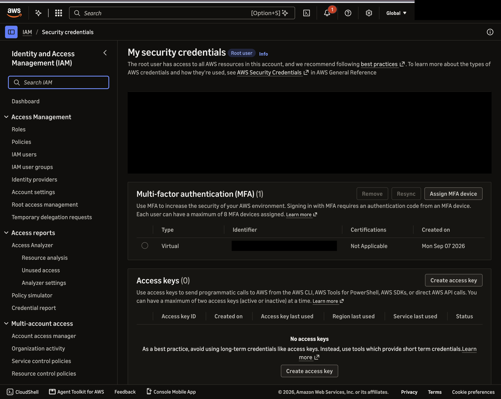
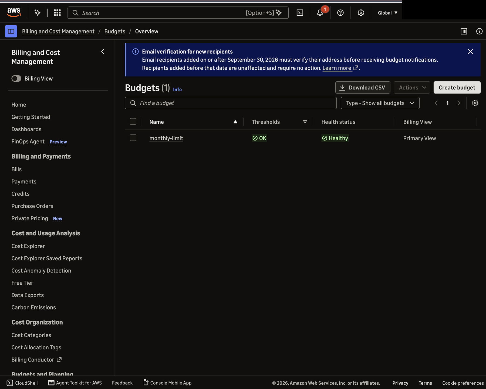
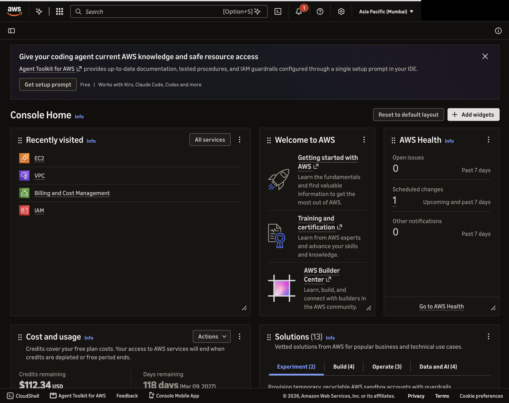
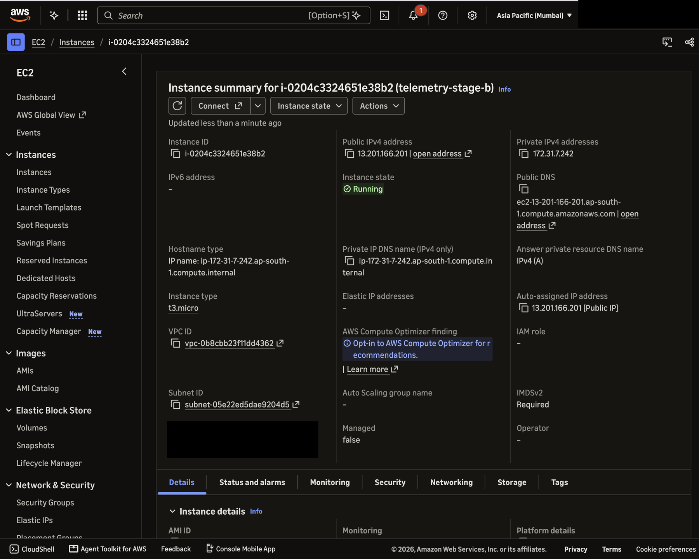
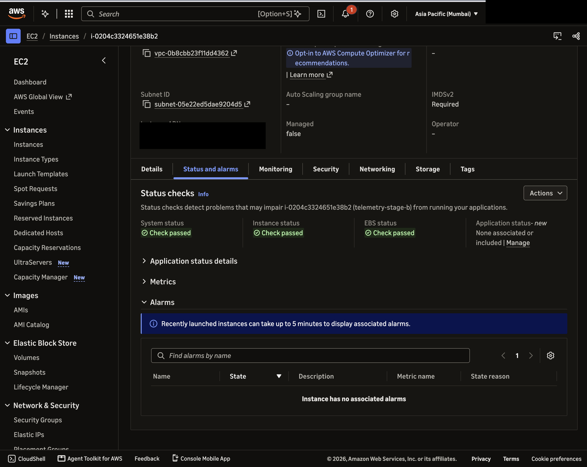
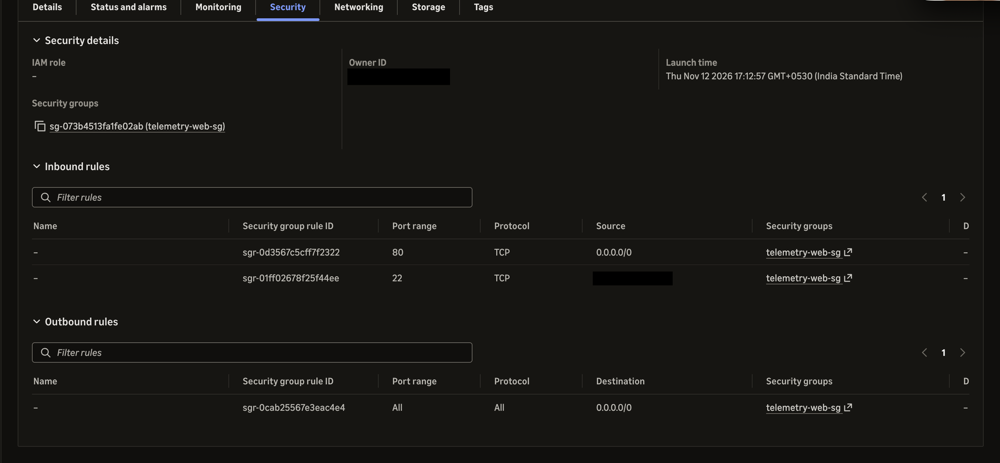
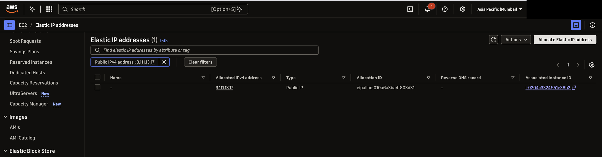
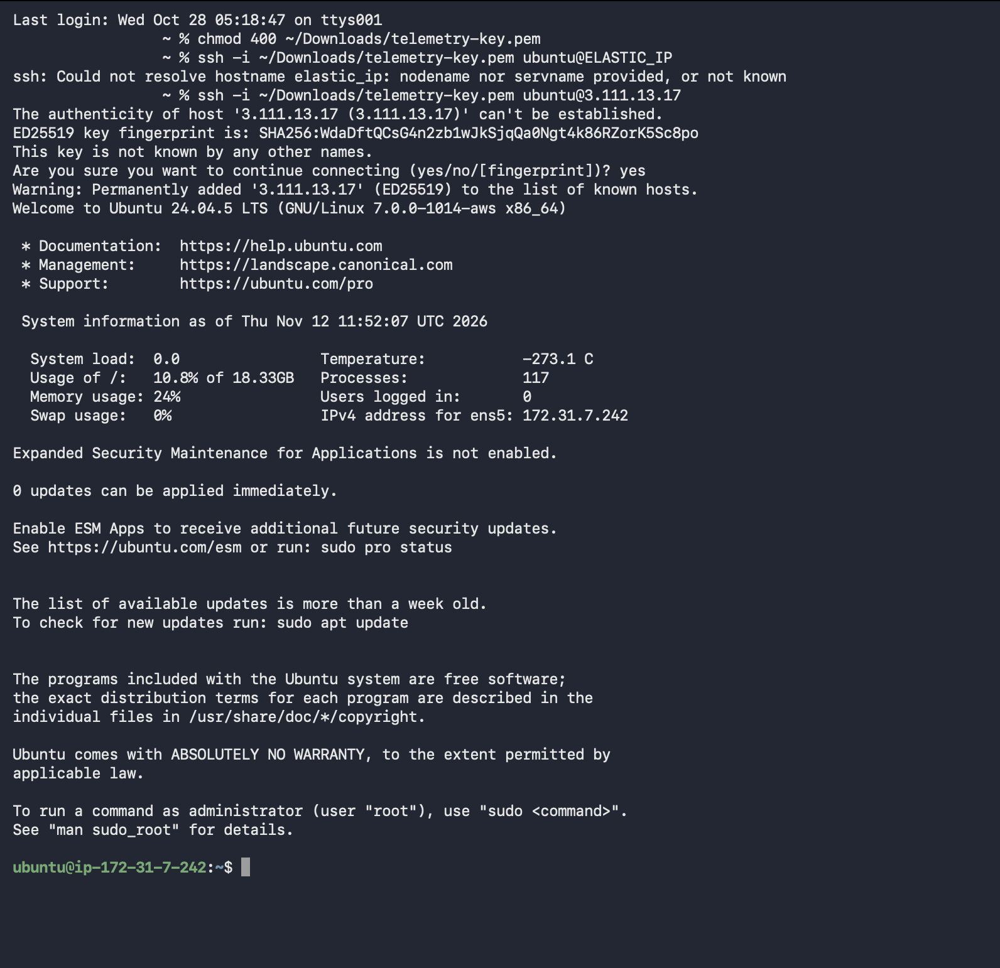

# Stage B: EC2 Launch Log

This log records how the EC2 machine for Stage B was created. Everything here comes from what we did in the AWS console. Screenshots are in `docs/screenshots/` with the account ID hidden. The `.pem` key file is not in the repo.

## 1. Account and basics

| Item | What we found |
|------|---------------|
| Account type | AWS free plan. The console shows 112.34 USD of credits remaining and 118 days left. Credits cover the free plan costs. |
| Sign in | Root user of the account. We did not create an IAM user. All three of us use this one account. |
| MFA | Turned on for the root user (one virtual MFA device). |
| Access keys | None created. |
| Budget | A monthly cost budget called `monthly-limit` exists. Status OK and Healthy. The console says new email recipients must verify their address before they get budget alerts, so the budget email still has to be verified. |
| Region | Asia Pacific (Mumbai), `ap-south-1`. All resources use this region. |

## 2. The instance

| Setting | Value |
|---------|-------|
| Name | `telemetry-stage-b` |
| Instance ID | `i-0204c3324651e38b2` |
| Operating system | Ubuntu Server 24.04 LTS (the login banner shows Ubuntu 24.04.5 LTS) |
| Instance type | `t3.micro` |
| Storage | 20 GiB gp3 (the machine reports about 18.3 GB usable) |
| Network | Default VPC `vpc-0b8cbb23f11dd4362`, subnet `subnet-05e22ed5dae9204d5`, private IP `172.31.7.242` |
| Key pair | `telemetry-key` (`.pem` file kept outside the repo) |
| State | Running, all three status checks passed (system, instance, EBS) |

## 3. Security group `telemetry-web-sg`

| Direction | Port | Source or destination | Why |
|-----------|------|-----------------------|-----|
| Inbound | 80 (HTTP) | Anywhere (0.0.0.0/0) | So anyone can open the live URL |
| Inbound | 22 (SSH) | One IP address only (My IP, a /32 rule) | So only we can log in |
| Outbound | All | Anywhere | Default, lets the machine download packages |

## 4. Elastic IP (fixed address)

The instance first got an automatic public address (`13.201.166.201`). An automatic address changes when the machine is stopped, so we allocated an Elastic IP and attached it to the instance.

| Item | Value |
|------|-------|
| Elastic IP | `3.111.13.17` |
| Associated with | `i-0204c3324651e38b2` |
| Planned live URL | `http://3.111.13.17/` |

## 5. First login test

We connected from a Mac with `ssh -i ~/Downloads/telemetry-key.pem ubuntu@3.111.13.17`. The login worked and showed Ubuntu 24.04.5 LTS, system load 0.0, memory usage 24 percent, disk usage 10.8 percent. The first successful login came roughly 10 minutes after clicking Launch.

## 6. Steps and effort

Manual steps for creating the machine (each click-through of a form counts as one step):

1. Open EC2 and click Launch instance
2. Set the name
3. Choose the Ubuntu 24.04 image
4. Choose the instance type `t3.micro`
5. Create the key pair and download the `.pem` file
6. Create the security group with the SSH and HTTP rules
7. Set storage to 20 GiB
8. Click Launch and wait for the checks to pass
9. Allocate an Elastic IP
10. Associate the Elastic IP with the instance
11. Set the key file permissions (`chmod 400`)
12. Log in with SSH and check

Total: 12 manual steps.

| Measure | Value |
|---------|-------|
| Time from clicking Launch to the first SSH login | about 10 minutes |

## 7. Problems and fixes

| Problem | Fix |
|---------|-----|
| The first SSH attempt used the word `ELASTIC_IP` from the guide instead of the real address and failed with "Could not resolve hostname" | Replaced it with the real address `3.111.13.17` and it worked |
| The instance first showed an automatic public address, not the Elastic IP | Associated the Elastic IP. We use only the Elastic IP from now on |
| The Budgets page shows that the alert email must be verified | To check the inbox for the AWS verification email and confirm it |

## 8. Not done yet

- [ ] Install Docker, Nginx and the app
- [ ] Open `http://3.111.13.17/health` in a browser
- [ ] Check that RDS can be created on the free plan before Stage C
- [ ] Stop the instance when nobody is using it
